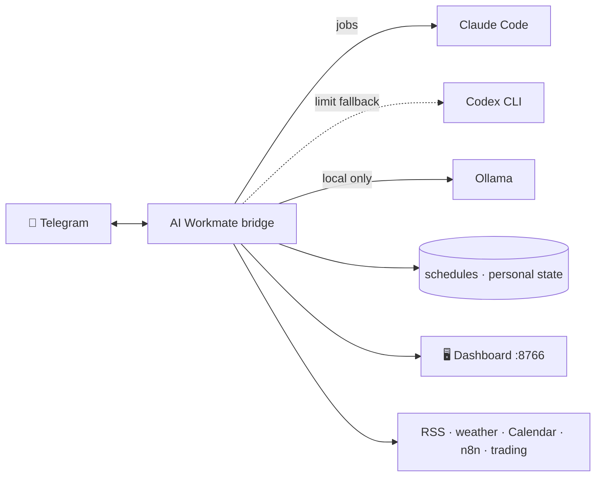

# 🤖 AI Workmate

**항상 켜져 있는 Mac에서 돌아가는 개인 업무 비서.**
텔레그램으로 AI에게 일을 맡기고, 매일 브리핑과 영어 단어를 받고, 로컬 대시보드에서 모든 걸 한눈에 확인합니다.


- **Claude Code 우선, Codex 자동 폴백**: 사용 한도에 걸려도 작업이 멈추지 않습니다.
- **로컬 우선**: 브리핑 추천과 영어 학습은 로컬 Ollama로 만들어 AI 사용량을 쓰지 않습니다.
- **승인 기반 안전장치**: 외부로 나가는 작업, 관리자 작업, 재시작은 텔레그램 버튼으로 승인해야 실행됩니다.
- **외부 의존성 0개**: Node 표준 라이브러리만 씁니다.

---

## 목차

| | 기능 | 한 줄 요약 |
|---|---|---|
| 💬 | [텔레그램 AI 작업](#-텔레그램-ai-작업) | 메시지 한 줄로 Claude/Codex 작업 실행, 답장으로 이어서 대화 |
| 🗓️ | [예약과 알림](#️-예약과-알림) | "내일 오후 3시에 알려줘" 같은 자연어 예약 |
| ☀️ | [개인 브리핑](#️-개인-브리핑) | 아침·저녁 브리핑, 주간 리뷰, AI 트렌드 |
| 📘 | [매일 영어 학습](#-매일-영어-학습) | 실제 뉴스 기사로 단어·예문·복습 퀴즈 |
| 📥 | [Inbox · 웹 감시 · AI 실험실](#-inbox--웹-감시--ai-실험실) | 할 일·읽을거리 수집, 페이지 변경 감시, 야간 리서치 |
| 🖥️ | [대시보드](#️-대시보드) | 오늘 · AI 실험실 · 자동화 · Trading · 시스템 · 설정 |
| 🧰 | [저장소 점검](#-저장소-점검) | 하네스 검증과 GitHub 공개 전 비밀값 점검 |
| 📊 | [AI 사용량 보고서](#-ai-사용량-보고서) | 엔진별 작업 수, 폴백, 실패, 토큰 |
| 🛡️ | [승인과 안전장치](#️-승인과-안전장치) | 허용 목록, 인라인 승인, 안전한 재시작 |
| 🩺 | [운영 모니터링 · 백업](#-운영-모니터링--백업) | 이상 시에만 알림, 외장 SSD 백업 |
| 🔌 | [연동](#-연동) | n8n, Trading dry-run, 포트폴리오, 텔레그램 전송 CLI |



---

## 💬 텔레그램 AI 작업

허용된 채팅에서 보낸 메시지가 작업이 됩니다. 선택한 workspace 안에서 샌드박스로 실행되고, 결과는 텔레그램으로 돌아옵니다.

- **엔진**: 기본은 Claude Code(`claude -p --output-format stream-json`)입니다. Claude가 사용 한도에 걸리거나 실행에 실패하면 같은 작업을 Codex로 한 번 다시 실행합니다. 결과에는 `Fallback: Codex (...)`가 표시됩니다.
- **한도 학습**: 실제 작업의 `rate_limit_event`에서 5시간·7일 사용률을 기록합니다. 사용률이 `CLAUDE_FALLBACK_UTILIZATION` 이상이면 새 작업을 바로 Codex로 보냅니다. 한도를 확인하려고 따로 요청을 보내지는 않습니다.
- **대화 이어가기**: 봇의 완료 메시지에 답장하면 그 세션(`claude --resume` / `codex exec resume`)을 이어서 진행합니다.
- **첨부 파일**: 사진·문서·음성·영상은 workspace의 `.ai-workmate/inbox/<chat-id>`에 저장되고, 신뢰할 수 없는 첨부로 표시돼 전달됩니다. 작업 중 만들어진 이미지는 결과와 함께 올라옵니다.
- **URL만 보내면** AI를 쓰지 않고 읽기 목록에 바로 저장합니다.

| 명령 | 설명 |
|---|---|
| 일반 메시지 | 현재 workspace에서 샌드박스 작업 실행 |
| `/admin <요청>` | 시스템 전체 권한 작업 (승인 버튼 필요) |
| `/delegate <요청>` · `/delegates` · `/delegate-cancel <id>` | 동시에 도는 별도 작업 |
| `/status` · `/jobs` · `/job <id>` · `/job-logs <id>` · `/cancel` | 작업 상태 확인과 취소 |
| (작업 중 새 요청) | "백그라운드로 실행" 버튼으로 기다리지 않고 별도 작업으로 맡기기 |
| `/dashboard` | 진행 중인 작업, 동시 작업 여유, 프로세스, 예약 요약 |
| `/new` · `/reset` | 답장으로 이어지던 세션 초기화 |
| `/remember <내용>` · `/memories` · `/forget <id>` | workspace별 메모리 |
| `/workspaces` · `/workspace [alias]` | 작업 위치 확인·전환 |
| `/serve <명령>` · `/ps` · `/logs <id>` · `/stop <id>` | 백그라운드 서버 관리 |
| `/research <주제>` · `/brief` · `/incident <내용>` | 출처 있는 리서치, 운영 요약, 장애 진단 |
| `/file <경로>` | workspace 파일 받기 |
| `/help` · `/help <주제>` | 한국어 기능 안내 (주제: ai, schedule, inbox, ops, workspace). 텔레그램 "/" 메뉴에도 등록됩니다 |
| `/tools` · `/capabilities` | 사용 가능한 도구 목록 |

결과 메시지 끝에는 `✅ Claude · 2분 · /job <id>`처럼 엔진, 걸린 시간, 상세 명령이 한 줄로 붙습니다.

---

## 🗓️ 예약과 알림

```text
10분 후에 알려줘
내일 오후 3시에 부모님께 전화하라고 알려줘
평일 오전 9시에 일정 확인하라고 알려줘
매일 오후 2시에 AI 뉴스 스크랩해서 알려줘
```

- 단순 알림은 AI를 쓰지 않고 바로 보냅니다. AI 사용량이 일시 중지된 동안에도 알림은 그대로 갑니다.
- 리서치·요약처럼 AI가 필요한 요청은 예약 시각에 샌드박스 작업으로 실행되고, 끝나면 결과를 보냅니다.
- `/schedule in 10m <요청>`, `/schedule every 1h <요청>`, `/schedule 매일 9시 <요청>`, `/schedule 평일 9시 <요청>`
- `/schedules`는 이름, 반복(매일·평일 08:00 등), 다음 실행 시각(KST)을 보여 줍니다. `/unschedule <id>`로 지우고, `/runnow <id>`로 지금 실행, `/skip <id>`로 한 번 건너뜁니다.
- AI 사용 한도에 걸리면 AI 예약 작업만 잠시 멈추고 한 번 안내합니다. 정지는 Codex 계정의 한도 리셋 시각까지이고(모르면 6시간), 정지 중 15분마다 한도를 다시 읽어 먼저 풀리면 바로 재개하며 재개도 한 번 알립니다. 한도 때문에 실패한 예약은 실패로 세지 않습니다. 모닝·이브닝 브리핑, 영어 학습, 단순 알림은 계속 발송되고, `/resume`으로 바로 풀 수 있습니다.
- 예약 작업 실패 알림은 실패가 시작될 때 한 번만 옵니다. 같은 예약이 성공한 뒤 다시 실패하면 그때 다시 알립니다.
- 예약은 재시작해도 한 번만 실행됩니다. 실행 전에 다음 회차를 먼저 저장하기 때문입니다.

---

## ☀️ 개인 브리핑

시작할 때 아래 예약을 한 번씩 만듭니다. 이미 있으면 다시 만들지 않습니다. `PERSONAL_BRIEFINGS_ENABLED=false`로 모두 끌 수 있습니다.

| 브리핑 | 기본 시각 | 만드는 방식 |
|---|---|---|
| 🌅 모닝 브리핑 | `MORNING_BRIEF_TIME` 08:00 | 날씨·Apple Calendar·Inbox를 코드로 정리하고, 추천은 로컬 Ollama가 만듭니다 |
| 🌙 이브닝 브리핑 | `EVENING_BRIEF_TIME` 20:00 | 내일 일정, trading dry-run 결과, 추천 |
| 🗂️ 주간 리뷰 (일요일) | `WEEKLY_REVIEW_TIME` 20:30 | 로컬 데이터만 사용하고, 끝에 AI 사용량과 저장소 점검 결과를 코드로 덧붙입니다 |
| 🧠 AI 트렌드 | `AI_TREND_BRIEF_TIME` 12:00 | 검색 횟수를 제한한 리서치 (저비용 예약 모델) |
| 📘 영어 학습 | `ENGLISH_STUDY_TIME` 12:10 | 아래 [매일 영어 학습](#-매일-영어-학습) 참고 |

- 공휴일, 주말, 캘린더의 휴가·연차·반차·휴무 일정을 보고 평일 모드와 쉬는 날 모드를 자동으로 바꿉니다.
- 날씨는 `WEATHER_LATITUDE`·`WEATHER_LONGITUDE` 좌표를 쓰고, 추천 장소는 `PERSONAL_LOCATION`을 기준으로 거리를 판단합니다.
- "이 추천은 좋았어", "이런 추천은 하지 마" 같은 말은 선호로 저장할지 버튼으로 묻습니다. `/preference add <like|avoid> <내용>`으로 직접 추가할 수도 있습니다.
- `/morning`, `/evening`, `/weekly-review`, `/ai-trends`, `/discover`(오늘의 추천)로 바로 받아볼 수 있습니다.
- Ollama가 꺼져 있으면 추천은 미리 정해 둔 목록에서 돌아가며 고릅니다.

---

## 📘 매일 영어 학습

매일 12:10에 실제 영어 뉴스 기사에서 단어 5개를 골라 보냅니다. Breaking News English를 먼저 보고, 없으면 DW에서 고릅니다. `/english`로 바로 받을 수도 있습니다.

```text
📘 영어 학습 · 10월 24일 (토)

📰 One billion meals thrown away every day
해석: 매일 버려지는 식사 10억 끼

📚 오늘의 단어
• accelerate (v.) 가속시키다, 촉진하다
  “As discarded food decomposes in landfills, it releases methane, which accelerates global warming.”
  → 버려진 음식이 매립지에서 분해되며 메탄을 내보내고, 이것이 지구온난화를 가속화합니다.
• ingredient (n.) 재료, 성분
  ...

🔁 복습 (3일 전)
• resilient → ?
  정답: 회복력 있는

🔗 BNE · https://breakingnewsenglish.com/...
```

- **AI 사용량 0**: RSS, 무료 사전 API(dictionaryapi.dev, 응답하지 않으면 건너뜀), macOS 단어 목록, 로컬 Ollama(`LOCAL_BRIEFING_MODEL`)만 씁니다.
- **문맥 품사**: 기사 문장 속 형태(`travelled`)를 보고 품사와 원형(`travel`, v.)을 정합니다.
- **반복 학습**: 3일 전과 7일 전 단어를 퀴즈로 다시 냅니다. 같은 단어는 60일 동안, 같은 기사는 다시 고르지 않습니다.
- **대체 경로**: Ollama가 실패하면 고정 주간 교재를 보내고, 교재 파일도 없으면 영어 정의만 넣어 보냅니다. 모델 출력이 형식에 맞지 않으면 그대로 보내지 않습니다.
- **고정 주간 교재**: `npm run english-study:build`가 `english-study-weekday-hourly.md`를 읽어 요일·시간별 수업을 만듭니다. 형식은 `english-study.example.md`를 참고하세요.

---

## 📥 Inbox · 웹 감시 · AI 실험실

```text
/inbox add task 이번 주 보증서 정리
/inbox add 읽기 https://example.com/article
/watch https://example.com/releases 제품 릴리스
/lab now 개인 사진 아카이브의 중복 제거 전략
```

- **빠른 기록**: `할일: 우유 사기 내일`, `메모: …`, `아이디어: …`, `읽기: <URL>`처럼 보내면 AI 없이 바로 Inbox에 저장됩니다. 끝에 `오늘`·`내일`·`모레`·`10/30`·`10월 30일`을 붙이면 기한이 됩니다.
- **Inbox**: 할 일, 읽을거리, 아이디어, 문서, 일기, 요청을 모아 두고 `/done`, `/snooze <id> [시간]`, `/archive`로 정리합니다. 모닝 브리핑의 "오늘의 초점"은 기한이 임박한 항목, 없으면 가장 오래 기다린 항목을 고르고 [완료]·[내일로] 버튼을 붙입니다.
- **웹 감시**: `/watches`로 목록을 보고 `/unwatch <id>`로 멈춥니다. 처음 확인한 내용을 기준으로 두고, 본문이 의미 있게 바뀔 때만 바뀐 줄 몇 개와 함께 알립니다. localhost, 사설망, 인증 정보가 든 URL, HTTP가 아닌 주소는 거부합니다.
- **AI 실험실**: `/lab now <주제>`로 리서치를 바로 맡기고, `/lab list`·`read`·`archive`·`restore`로 결과를 관리합니다. `/lab practice|implement|research <id> <과제>`로 후속 작업을 이어 붙일 수 있습니다. 결과는 Markdown 보고서로 `documents/reports/`에 남습니다.
- **창작 작업**: `/creative tonight <요청>`은 23:00에 테스트까지 거친 결과물을 만듭니다.

---

## 🖥️ 대시보드

`http://127.0.0.1:8766/`에서 열립니다. localhost에만 바인딩되며, 휴대폰에서 보려면 tailnet에만 공개하세요.
DNS rebinding을 막기 위해 Host가 loopback, `*.ts.net`, `DASHBOARD_ALLOWED_HOSTS`가 아니면 거부하고, 실행 요청은 같은 출처에서 온 것만 받습니다.

```bash
tailscale serve --bg http://127.0.0.1:8766
```

| 탭 | 내용 |
|---|---|
| 오늘 | 상태 줄(AI 예약 일시정지·실패 중인 예약과 해제/지금 실행 버튼), 요청 입력창("텔레그램으로도 받기"), 결과 전문 보기, 할 일·Inbox(기한, N일째, 미루기), 최근 브리핑(전문, 👍/👎, 다시 보내기), 다음 일정, 사용 한도 |
| AI 실험실 | 문서함(Markdown 뷰어), 조사 보고서와 후속 작업, 실험 대기열과 결과 |
| 자동화 | n8n 워크플로(실행·재시도·게시), 실패한 자동화, 예약 작업(지금 실행·한 번 건너뛰기·삭제), 최근 AI 작업, 관리 프로세스 |
| Trading | 오늘의 dry-run(포지션·주문·후보 종목·실험), 내 보유자산 |
| 시스템 | Mac과 서비스 상태, 외장 저장소와 사진 백업(설정한 경우), 코드 저장소 점검(24시간 지나면 "오래됨"과 재점검 버튼) |
| 설정 | 추천 선호, 사용량과 브리핑 상태(지연 발송·피드백·로컬 생성 실패), 접근 보안, 보관함 |
| 이모티콘 | 형제 폴더 imoticon-maker와 연동하는 이모티콘 작업 화면 (`harness/specs/emoticon-studio.md`) |

대시보드에서 보낸 요청도 텔레그램 요청과 똑같이 정산됩니다. 사용량에 기록되고, 결과는 텔레그램으로도 와서 답장으로 이어갈 수 있습니다. 결과 전문은 재시작 후에도 대시보드에서 다시 볼 수 있습니다.
`DASHBOARD_TAILNET_USERS`를 설정하면 `*.ts.net`으로 들어온 실행 요청은 그 목록의 tailnet 사용자만 할 수 있습니다.

---

## 🧰 저장소 점검

매일 `REPO_CHECK_HOUR`(기본 07시)가 지나면 `REPO_CHECK_ROOT`(기본: 이 저장소의 상위 폴더) 아래 저장소들을 **읽기만 하며** 점검합니다. 결과는 모닝 브리핑, 주간 리뷰, 대시보드에 표시됩니다.

- **하네스 저장소**: `harness-lab audit`, 최신 `checks.json`의 `check-evidence`, 30일이 지난 유지보수 리뷰
- **공개 전 점검**: Git이 커밋할 파일만 봅니다(Git이 아닌 폴더도 임시 Git 디렉터리로 같은 규칙 적용).
  - 차단: 개인 키, 알려진 토큰 형식(URL 안에 들어 있는 텔레그램 토큰 포함), 따옴표로 감싼 비밀값 대입, `.env` 파일
  - 경고: 홈 디렉터리 경로, `PUBLISH_CHECK_PRIVATE_TERMS`(예: 이메일), 5 MB 넘는 파일
  - 누락: README, LICENSE, `.gitignore`
- 결과에는 규칙 이름, 파일, 줄 번호만 남기고 **매칭된 내용은 남기지 않습니다**.
- `/repos`로 전체를 점검하고, `/publish-check <저장소>`로 한 저장소만 봅니다.

---

## 📊 AI 사용량 보고서

`/ai-usage [일수]`로 다음 항목을 봅니다.
- 엔진별(Claude·Codex·로컬) 작업 수
- Codex 폴백 횟수와 이유
- 실패, 브리핑 품질 재시도
- 토큰, 토큰을 많이 쓴 작업
- 현재 Claude 5시간·7일 사용률

주간 리뷰 끝에 붙는 숫자는 모델이 쓰지 않고 코드가 계산해서 넣습니다. 이 보고서는 작업량을 셀 뿐, 결과 품질을 평가하지는 않습니다.

---

## 🛡️ 승인과 안전장치

- **허용 목록**: `ALLOWED_CHAT_IDS` / `ALLOWED_USER_IDS`에 없는 사용자의 요청은 무시하거나 거절합니다(`DENY_MODE`).
- **인라인 승인**: 아래 작업은 텔레그램 버튼을 눌러야 실행됩니다. 대시보드에서 보낸 요청도 같은 흐름을 거칩니다.
  - 외부 상태를 바꾸는 요청(전송, 삭제, 게시, 배포)
  - `git push`나 GitHub 업로드 요청
  - `/admin` 요청
  - 대시보드에서 보낸 요청이 승인 대상이면 승인 버튼은 텔레그램으로 갑니다. 대시보드에서는 `/ask` 뒤에 명령을 붙여 허용 목록을 우회할 수 없습니다.
- **비밀값 격리**: AI 작업과 `/serve` 프로세스에는 `TELEGRAM_BOT_TOKEN`과 허용 목록 환경변수를 넘기지 않습니다. `/serve`의 `node`·`python3`는 스크립트 파일만 실행할 수 있고 `-e`·`-c` 같은 인라인 코드는 거부합니다. `/file`은 symlink를 따라가 workspace 밖 파일을 보내지 않습니다.
- **샌드박스**: 일반 작업은 선택한 workspace 안에서 실행됩니다(Claude는 `acceptEdits` + Bash 샌드박스, Codex는 `--sandbox workspace-write`). 웹 도구는 리서치·브리핑·장애 진단 모드에서만 씁니다.
- **안전한 재시작**: `/restart`는 승인 버튼을 받은 뒤 `launchctl kickstart -k`를 실행합니다.
  - 버튼을 누르는 순간에 실행 중인 작업이 있으면 재시작하지 않습니다.
  - 재시작이 끝나면 같은 채팅에 완료를 알립니다.
  - 대시보드에서는 쓸 수 없습니다.

---

## 🩺 운영 모니터링 · 백업

- 정상일 때는 조용합니다. 다음 경우에만 알립니다.
  - 예약된 브리핑이 오지 않음
  - 외장 SSD 연결 끊김 또는 용량 부족
  - 사진 백업이 오래됨
  - 예약 작업이 실패함 (예약 이름, 원인, `/runnow <id>` 안내. 같은 실패 상태는 한 번만)
  - 활성 n8n 워크플로 실행 실패 (하루 1번 요약)
- 늦게 만든 브리핑에는 `⏰ 지연 발송 (원래 20:00)`이 붙습니다.
- 알림 간격과 30일 사용량 지표는 재시작해도 유지됩니다.
- 브리지 자체가 죽으면 안에서 알릴 수 없으므로, 별도 watchdog이 5분마다 대시보드를 확인합니다. 두 번 연속 응답이 없으면 한 번, 복구되면 한 번 텔레그램으로 알립니다. `npm run install:watchdog`으로 설치합니다.
- `/health`로 AI Workmate, n8n, Trading, Ollama, 외장 저장소 상태를 확인합니다.
- `npm run personal-ops:backup`은 상태 JSON과 n8n SQLite를 `EXTERNAL_STORAGE_PATH`에 백업합니다. 오래된 백업은 목록만 보여 주고 지우지 않습니다.

---

## 🔌 연동

- **n8n**: `/n8n <요청>`으로 워크플로를 점검하고 바꿉니다. 대시보드에서도 실행·재시도·게시할 수 있습니다. `./start-n8n.sh start|restart|stop`은 `TZ`와 `GENERIC_TIMEZONE`을 `Asia/Seoul`로 맞춰 실행합니다.
- **Trading dry-run**: `/tr 보유 | 설정 <종목> 익절 <%> 손절 <%> | 매도 <종목>`. 형제 폴더 `../trading`을 쓰며, 위치는 `TRADING_WORKSPACE_PATH`로 바꿀 수 있습니다.
- **포트폴리오**: `data/portfolio.example.json`을 `data/portfolio.json`으로 복사하면 대시보드에 평가 금액이 표시됩니다.
- **텔레그램 전송 CLI**: `npm run telegram:send -- --text "hello"`(또는 `--file`, `--stdin`). 받는 채팅은 `--chat-id` → `DEFAULT_TELEGRAM_TARGET_CHAT_ID` → `ALLOWED_CHAT_IDS`의 첫 값 순서로 정합니다. n8n 같은 외부 스케줄러가 봇 토큰을 따로 갖지 않아도 됩니다.

---

## 🚀 시작하기

### 준비물

- macOS, Node 20+
- [Claude Code](https://docs.claude.com/en/docs/claude-code) CLI (기본 엔진), [Codex CLI](https://github.com/openai/codex) (폴백, `AI_PROVIDER=codex`로 Codex만 쓸 수도 있음)
- 텔레그램 봇 토큰 (BotFather에서 발급)
- 선택: [Ollama](https://ollama.com) (`qwen3.5` 등, 로컬 추천·영어 학습), n8n, Tailscale

### 설치와 텔레그램 연결

```bash
git clone https://github.com/bon-on/ai-workmate.git
cd ai-workmate
cp .env.example .env          # TELEGRAM_BOT_TOKEN, CODEX_WORKSPACE 등 입력
```

1. `.env`에 `TELEGRAM_BOT_TOKEN`을 넣고, `CODEX_WORKSPACE`에 이 저장소 경로를 지정합니다.
2. 텔레그램에서 봇에게 아무 메시지나 한 번 보냅니다.
3. 웹훅이 걸려 있으면 지웁니다: `npm run telegram:webhook` → `npm run telegram:webhook:delete`
4. `npm run telegram:updates`로 내 `chat.id`를 찾아 `ALLOWED_CHAT_IDS`에 넣습니다.
5. `npm start`

### 상시 실행 (launchd)

```bash
npm run install:startup       # 로그인 시 자동 시작, KeepAlive
npm run install:watchdog      # 브리지 밖에서 5분마다 상태 확인
```

- 서비스 이름은 `AI_WORKMATE_LAUNCHD_LABEL`(기본 `com.ai-workmate.bridge`)이고, 환경변수나 `.env`에서 읽습니다.
- 텔레그램 네트워크 오류가 나도 프로세스 안에서 재시도하므로 예약과 대시보드는 멈추지 않습니다. 10 MB를 넘는 로그는 자동으로 잘라냅니다.
- launchd 없이 실행하려면 `npm run start:daemon | status:daemon | stop:daemon`을 씁니다. LaunchAgent와 동시에 쓰지 마세요.

---

## ⚙️ 설정

`.env.example`에 자주 쓰는 값이 들어 있습니다. 필수 값은 `TELEGRAM_BOT_TOKEN`, `CODEX_WORKSPACE`, 그리고 `ALLOWED_CHAT_IDS`와 `ALLOWED_USER_IDS` 중 하나입니다.

<details>
<summary><b>텔레그램 · 접근</b></summary>

| 변수 | 설명 |
|---|---|
| `TELEGRAM_BOT_TOKEN` | 봇 토큰 |
| `ALLOWED_CHAT_IDS` / `ALLOWED_USER_IDS` | 허용할 채팅·사용자 ID (쉼표로 구분) |
| `DEFAULT_TELEGRAM_TARGET_CHAT_ID` | 브리핑과 CLI 전송의 기본 채팅 |
| `DENY_MODE` | 허용되지 않은 요청에 `reply` 또는 `silent` |
| `TELEGRAM_UNRESTRICTED_ENABLED` | `/admin` 허용 (기본 `true`, 그래도 승인 버튼 필요) |
| `POLL_TIMEOUT_SECONDS`, `TELEGRAM_REQUEST_TIMEOUT_MS`, `POLL_RETRY_MIN_MS`, `POLL_RETRY_MAX_MS`, `POLL_RESTART_FAILURE_THRESHOLD`, `POLL_RESTART_WINDOW_MS` | polling 시간 제한과 재시도 |
| `MAX_INCOMING_FILE_BYTES` | 받을 첨부 파일 최대 크기 |

</details>

<details>
<summary><b>AI 엔진</b></summary>

| 변수 | 설명 |
|---|---|
| `AI_PROVIDER` | `claude`(기본) 또는 `codex` |
| `CLAUDE_BIN`, `CLAUDE_MODEL` | Claude CLI 경로와 모델 |
| `CLAUDE_FALLBACK_UTILIZATION` | 이 사용률 이상이면 Codex로 전환 (예: `0.95`) |
| `CLAUDE_LIMIT_STATE_PATH`, `CLAUDE_RATE_LIMIT_SNAPSHOT` | 학습한 한도 저장 위치, statusline이 쓰는 사용률 파일 |
| `CLAUDE_MCP_CONFIG` | `/n8n`을 Claude로 실행할 MCP 설정 (없으면 Codex) |
| `SCHEDULED_CLAUDE_MODEL`, `SCHEDULED_CLAUDE_EFFORT` | 예약 브리핑용 Claude 모델과 effort |
| `CODEX_BIN`, `CODEX_MODEL`, `CODEX_PROFILE` | Codex CLI 설정 |
| `SCHEDULED_CODEX_MODEL`, `SCHEDULED_CODEX_REASONING_EFFORT` | 폴백 시 예약 작업 모델 |
| `JOB_TIMEOUT_MS`, `MAX_LOG_BYTES` | 작업 시간 제한, 채팅에 보여 줄 로그 크기 |
| `MAX_DELEGATE_JOBS_PER_CHAT`, `MAX_DELEGATE_JOBS_TOTAL` | 동시 작업 수 제한 |

</details>

<details>
<summary><b>Workspace · 상태 파일</b></summary>

| 변수 | 설명 |
|---|---|
| `CODEX_WORKSPACE` | 기본 workspace |
| `ALLOWED_WORKSPACES` | `alias=/abs/path` 목록 (쉼표로 구분) |
| `SESSION_STATE_PATH`, `MEMORY_STATE_PATH`, `SCHEDULE_STATE_PATH`, `PERSONAL_OPS_STATE_PATH` | 세션·메모리·예약·개인 상태 저장 위치 (기본 `~/.codex/`) |
| `SCHEDULE_MAX_FAILURES` | 반복 예약을 끄기 전까지 허용할 실패 횟수 |
| `TRANSCRIPTION_MODEL_PATH` | 음성 받아쓰기 모델 |

</details>

<details>
<summary><b>브리핑 · 영어 학습 · 로컬 모델</b></summary>

| 변수 | 설명 |
|---|---|
| `PERSONAL_BRIEFINGS_ENABLED` | 개인 예약 전체 켜기·끄기 |
| `MORNING_BRIEF_TIME`, `EVENING_BRIEF_TIME`, `WEEKLY_REVIEW_TIME`, `AI_TREND_BRIEF_TIME` | `HH:MM` |
| `ENGLISH_STUDY_TIME`, `ENGLISH_STUDY_ENABLED` | 영어 학습 시각(기본 `12:10`)과 켜기·끄기 |
| `PERSONAL_LOCATION`, `WEATHER_LATITUDE`, `WEATHER_LONGITUDE` | 추천 기준 위치와 날씨 좌표 |
| `OLLAMA_PORT`, `LOCAL_BRIEFING_MODEL` | 로컬 모델 (기본 `11434`, `qwen3.5:latest`) |

</details>

<details>
<summary><b>대시보드 · 운영 · 점검</b></summary>

| 변수 | 설명 |
|---|---|
| `DASHBOARD_ENABLED`, `DASHBOARD_HOST`, `DASHBOARD_PORT` | 기본 `true`, `127.0.0.1`, `8766` |
| `DASHBOARD_ALLOWED_HOSTS` | 대시보드에 접속할 수 있는 추가 호스트 이름 (loopback과 `*.ts.net`은 기본 허용) |
| `DASHBOARD_TAILNET_USERS` | `*.ts.net`으로 실행 요청을 보낼 수 있는 tailnet 로그인(쉼표 구분). 비우면 tailnet의 모든 기기가 가능 |
| `IMOTICON_MAKER_PATH`, `IMOTICON_PYTHON` | 이모티콘 탭이 쓰는 imoticon-maker 체크아웃(기본 `../imoticon-maker`)과 Python(기본 `python3`) |
| `TRADING_DASHBOARD_PORT`, `N8N_PORT` | 허브에 표시할 서비스 포트 |
| `OPERATIONAL_MONITORING_ENABLED` | 이상 알림 (기본 `true`) |
| `EXTERNAL_STORAGE_PATH`, `PHOTO_BACKUP_PATH` | 외장 SSD와 사진 백업 경로 |
| `REPO_CHECKS_ENABLED`, `REPO_CHECK_HOUR`, `REPO_CHECK_ROOT`, `HARNESS_LAB_CLI`, `PUBLISH_CHECK_PRIVATE_TERMS` | 저장소 점검 |
| `AI_WORKMATE_LAUNCHD_LABEL`, `RESTART_NOTICE_PATH` | `/restart` 대상 서비스와 완료 안내 파일 |
| `TRADING_WORKSPACE_PATH` | `/tr`이 쓰는 trading 저장소 |

</details>

---

## 🔒 개인 데이터는 커밋되지 않습니다

`.gitignore`가 다음을 제외합니다.
- `.env`
- `data/`: `portfolio.example.json`만 공개
- `documents/`: README만 공개
- `out/`, `tmp/`, `backups/`, `models/`
- 영어 학습 원본 `english-study-weekday-hourly.md`
- 이 PC에서만 쓰는 `deploy/` 파일

`workflows/`의 n8n 워크플로는 `YOUR_TELEGRAM_BOT_TOKEN`·`YOUR_TELEGRAM_CHAT_ID` 자리 표시자를 쓰니, import하기 전에 바꾸거나 n8n credential을 연결하세요. 상태 파일은 기본으로 `~/.codex/` 아래에 저장되며 저장소 밖에 있습니다.

---

## 🧪 개발과 검증

```bash
npm test                      # node --test (외부 API는 모두 mock)
npm run verify:harness        # ../harness-lab 필요, out/evidence/harness-latest에 증거 생성
npm run audit:harness
```

- 기능 요구사항은 `harness/specs/`, 설계 결정은 `harness/adrs/`에 있습니다.
- 대시보드 브라우저 코드는 서버의 템플릿 문자열 안에 있어서, 테스트는 실제로 내보내지는 JavaScript를 대상으로 합니다.
- `npm run verify`는 단독 실행용 회귀 기록을 만듭니다. 공유 하네스 형식의 증거는 아닙니다.
- 테스트 통과 수는 회귀 검사 결과일 뿐입니다. 사실 정확성이나 화면 검수를 보증하지는 않습니다.

## 📄 라이선스

[MIT](LICENSE)
